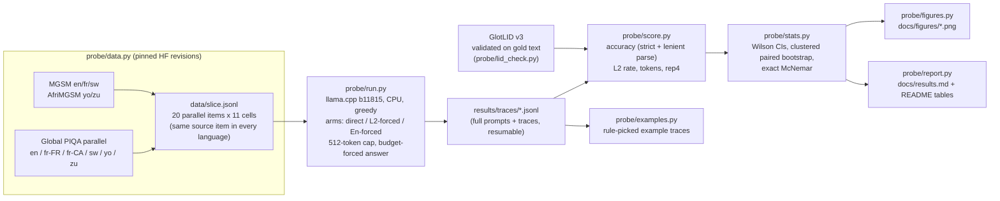
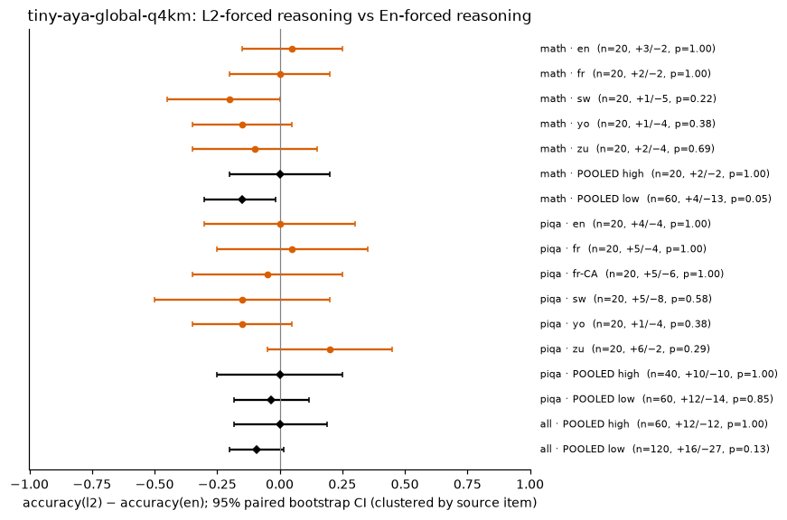

# Tiny Aya in-language reasoning probe: Canadian French and a low-resource tier, on CPU

Does making a small multilingual model **reason in the user's language** cost accuracy, compared with reasoning in English? Cohere Labs' [Multilingual Bridges](https://cohere.com/blog/building-multilingual-bridges) post (Oct 6, 2026; arXiv 2609.10445) reports four numbers for this question: the **L2 reasoning rate** (language ID over each trace), **accuracy**, **thinking tokens**, and a **repetition score** that catches doomlooping. This repo measures the same four numbers on a small slice that matters in Canada: **Canadian French** (Global PIQA `fra_latn_cana`), France French, and a low-resource tier (**Swahili, Yoruba, Zulu**). English is the control. Everything runs on one shared CPU box with no paid API.

> **Substitution, stated up front.** The brief's target pair, [`tiny-aya-l2-thinker`](https://huggingface.co/CohereLabs/tiny-aya-l2-thinker) and [`tiny-aya-en-thinker`](https://huggingface.co/CohereLabs/tiny-aya-en-thinker), is **gated** on Hugging Face. The build box has no HF token, every download returns HTTP 401, and no ungated mirror or GGUF of either model exists. This study therefore runs the documented substitute that the blog itself uses as its baseline: **inference-time language forcing**. The same model reasons with its opening words prefilled in the prompt language (*L2-forced*) or in English (*En-forced*). The model is the ungated official [`tiny-aya-global` Q4_K_M GGUF](https://huggingface.co/CohereLabs/tiny-aya-global-GGUF), which belongs to the same 3.35B Tiny Aya family and uses the same tokenizer. **None of the numbers below are L2-Thinker or En-Thinker numbers.** [`scripts/run_thinkers.sh`](scripts/run_thinkers.sh) swaps in the real thinkers once a token is available; it is **untested**.

## At a glance

<!-- GLANCE:start (generated by probe/report.py, do not edit) -->
| question | answer (L2-forced minus En-forced accuracy, 95% clustered-bootstrap CI) |
|---|---|
| Math, low-resource tier (sw, yo, zu) | -15 pp [-30, -2] (n=60 pairs, McNemar p=0.05) |
| Math, French | +0 pp [-20, +20] (n=20 pairs, McNemar p=1.00) |
| Math, English control | +5 pp [-15, +25] (n=20 pairs, McNemar p=1.00) |
| Commonsense, Canadian French | -5 pp [-35, +25] (n=20 pairs, McNemar p=1.00) |
| Commonsense, French (both locales) | +0 pp [-25, +25] (n=40 pairs, McNemar p=1.00) |
| Commonsense, low-resource tier | -3 pp [-18, +12] (n=60 pairs, McNemar p=0.85) |
| Both tasks, low-resource tier | -9 pp [-20, +2] (n=120 pairs, McNemar p=0.13) |
| Both tasks, French | +0 pp [-18, +19] (n=60 pairs, McNemar p=1.00) |

L2 rate on low-resource prompts: **98%** of L2-forced traces [94, 100] vs 12% of En-forced traces (n=120 / 120). Mean generated tokens: 157 (L2) vs 169 (En). Cap hits: 2 (L2) vs 1 (En).
<!-- GLANCE:end -->

## Pipeline



## Method

| | |
|---|---|
| Model | `tiny-aya-global-q4_k_m.gguf` (CohereLabs/tiny-aya-global-GGUF @ `a602ea7`, sha256 `d01d9952…`), served by llama.cpp `b11815` (CPU, `--jinja` chat template, `--swa-full` for prefix-cache reuse) |
| Items | 20 items per cell, sampled once with seed `20261022` and **shared across languages**: MGSM is parallel across languages and AfriMGSM translates the same 250 questions (gold answers align 250/250, asserted in `probe/data.py`); Global PIQA *parallel* shares `example_id` across languages. Every cross-language and cross-arm comparison is therefore paired. |
| Arms | **direct**: answer line prefilled, no reasoning (is reasoning worth anything here?). **L2-forced**: "Think step by step in the same language as the question" plus the reasoning prefilled with the dataset's own human-translated "Step-by-step answer:" phrase (MGSM / AfriMGSM exemplars; Zulu's phrase was written by the author and is not native-checked, see [`probe/langs.py`](probe/langs.py)). **En-forced**: "Think step by step in English" plus a "Step-by-Step Answer:" prefill. |
| Decoding | Greedy (temperature 0, top-k 1), so runs are reproducible. The reasoning cap is 512 generated tokens. On a cap hit the answer is budget-forced (`\n#### ` appended, 12 more tokens), and the hit is logged per trace. |
| Accuracy | *Lenient* (primary): the `#### <answer>` line if one exists, else the last number (math) or the last standalone option letter (PIQA). *Strict*: only the `####` line counts. Both are reported, and the gap is the format-compliance cost. |
| L2 rate | GlotLID v3 (`cis-lmu/glotlid` @ `85cd671`) on the whole trace, after math, LaTeX and numbers are stripped. The trace counts as L2 if the label is the prompt language (Swahili accepts `swh/swa/swc`). The prefilled opener is excluded, so only model-written text is scored. A sentence-level share is also computed. |
| Tokens | Generated tokens per trace (llama.cpp `predicted_n`, including the 3–5-token answer line). Both arms share one tokenizer, so token comparisons are fair within this study but not against the blog's numbers. |
| Repetition | `rep4` = 1 − unique/total word 4-grams in the trace, a simple version of the blog's "how often short sequences repeat". |
| Stats | Wilson 95% intervals for rates; a paired bootstrap (10k resamples) for L2−En differences, **clustered by source item** so the pooled cross-language numbers do not treat translations of one question as independent; exact McNemar on discordant pairs. n=20 per cell is small: single-cell intervals are about ±20 pp wide, and pooled rows carry the weight. |

### Is the language ID trustworthy here?


*Data: [`results/lid_validation.json`](results/lid_validation.json) · script: [`probe/lid_check.py`](probe/lid_check.py) · figure: [`probe/figures.py`](probe/figures.py).* GlotLID was run on the slice's own human-written questions before it was used on traces. Swahili sometimes comes back as Congo Swahili (`swc`), which counts as Swahili; Zulu is sometimes confused with other Nguni languages, so a lenient Zulu rate (also accepting `xho/nbl/ssw/nde`) is reported alongside. **GlotLID has a single `fra_Latn` label**, so the L2 rate cannot tell Canadian French from France French. The fr-CA result is about reasoning *on* Québécois-authored items, not about producing Québécois-register traces.

## Results

All numbers below are produced from the committed traces by [`probe/score.py`](probe/score.py) → [`results/summary.json`](results/summary.json) / [`results/paired.json`](results/paired.json) / [`results/per_trace.csv`](results/per_trace.csv). The tables are spliced in by [`probe/report.py`](probe/report.py), and every figure comes from [`probe/figures.py`](probe/figures.py). Full tables: [`docs/results.md`](docs/results.md).

### 1. Accuracy by language and arm


*Data: [`results/summary.json`](results/summary.json) · script: [`probe/figures.py`](probe/figures.py) (`fig_accuracy`).*

- **Reasoning matters a lot for math, in any language.** Direct answering scores 0–5% on every math language. Either reasoning arm lifts English and French to 60–70% (paired L2 vs direct on English and French math: +60 and +65 pp, McNemar p < 0.01; see [`docs/results.md`](docs/results.md)).
- **For French, forcing in-language reasoning costs nothing measurable.** French math is 70% vs 70%, with 2 items won by each arm. English (the control, where both arms mostly reason in English) is 65% vs 60%.
- **For the low-resource tier, forcing in-language reasoning costs math accuracy.** Pooled over Swahili, Yoruba and Zulu (60 paired items), L2-forced is **15 pp lower** than En-forced: 32% vs 47%, 95% CI [−30, −2], with 4 vs 13 discordant items (exact McNemar p = 0.05). Every low-resource language points the same way (sw −20, yo −15, zu −10 pp), but no single language is significant at n = 20.
- **Commonsense (Global PIQA): no measurable effect of reasoning language, and reasoning barely helps.** Accuracy is 25–55% for every arm and language (chance is 25%). On PIQA, L2-forced vs direct is −5 to +10 pp across the pooled groups, with every interval including 0. On **Canadian French**, L2-forced is 35% and En-forced is 40% (−5 pp [−35, +25], 5 vs 6 discordant items). France French is 30% vs 25%. The pooled low-resource PIQA difference is −3 pp [−18, +12]. Zulu (+20 pp) and Yoruba (−15 pp) point in opposite directions, so there is no consistent low-resource cost on this task at n = 20.

### 2. Did the forcing actually change the reasoning language? (L2 rate)


*Data: [`results/summary.json`](results/summary.json) (`l2`, `en_trace`) · per-trace labels: [`results/per_trace.csv`](results/per_trace.csv) · script: [`probe/figures.py`](probe/figures.py) (`fig_lid_heatmap`).*

The manipulation worked: the L2-forced arm reasons in the prompt language for nearly every trace, including Yoruba and Zulu, and the En-forced arm mostly reasons in English. The arms therefore differ in the language of the reasoning, which is the variable under study. The leak goes one way: some *En-forced* Swahili math traces drift back into Swahili, but L2-forced traces almost never drift into English.


*Data: [`results/per_trace.csv`](results/per_trace.csv) (`target_share`, `english_share`) and [`results/trace_lid_check.json`](results/trace_lid_check.json) · script: [`probe/trace_lid_check.py`](probe/trace_lid_check.py), [`probe/figures.py`](probe/figures.py) (`fig_trace_lid`).*

**Language-ID check on the traces themselves.** A whole-trace label can hide code-switching, so every trace was also split into sentences and each sentence labelled. The whole-trace label is cross-checked against the majority sentence label, and GlotLID's confidence is recorded in [`results/trace_lid_check.json`](results/trace_lid_check.json). Swahili disagreements are mostly `swh` vs `swc` (both Swahili). The few en-arm outliers are traces dominated by numbers and option text quoted from the prompt.

### 3. Tokens, repetition and doomlooping


*Data: [`results/per_trace.csv`](results/per_trace.csv) (`gen_tokens`, `rep4`, `cap_hit`) · script: [`probe/figures.py`](probe/figures.py) (`fig_rep_scatter`).*


*Data: [`results/summary.json`](results/summary.json) (`…|all|group:*`) · script: [`probe/figures.py`](probe/figures.py) (`fig_groups`).*


*Data: [`results/summary.json`](results/summary.json) (`tokens`) · script: [`probe/figures.py`](probe/figures.py) (`fig_tokens`).*

Traces are short for both arms: median 148 generated tokens, 5th–95th percentile 69–294, across all 440 reasoning traces. Only 3 of the 440 hit the 512-token cap. Repetition and length are positively correlated (Spearman ρ = 0.44 for L2-forced and 0.49 for En-forced; shown on the plot), which matches the blog's observation in miniature. At this scale, though, doomlooping is a handful of traces, not a regime. Forcing in-language reasoning does **not** make this model think longer.

### 4. Error analysis: why does L2 reasoning lose on low-resource math?


*Data: [`results/per_trace.csv`](results/per_trace.csv) (`eq_steps`, `list_lines`) and the table in [`docs/results.md`](docs/results.md#trace-structure-error-analysis-math) · script: [`probe/metrics.py`](probe/metrics.py) (`structure`), [`probe/figures.py`](probe/figures.py) (`fig_structure`).*

The two arms write in different *styles*, not only different languages. En-forced traces on low-resource prompts are enumerated, step-by-step derivations (6–8 list lines per trace). L2-forced Swahili, Yoruba and Zulu traces are a single prose paragraph (≈0 list lines), and Yoruba and Zulu L2 traces also contain fewer explicit arithmetic steps on average (2.6 vs 4.3 and 3.5 vs 5.2 `=` signs per trace). Reading the discordant items, the dominant L2 failure is **dropping a condition of the problem**, not arithmetic error:

- **`mgsm-058-sw` (gold 57):** the L2 trace adds the $3 fee and $4 tip but never applies the 25% charge (→ 47). The En trace lists it as its own step (→ 57).
- **`mgsm-012-yo` (gold 13):** the L2 trace ignores the $90 planting cost and divides revenue by upkeep (→ 4). The En trace includes it (→ 12.2, rounded up to 13).
- **`mgsm-015-sw` (gold 125):** both arms compute $125 and $96 correctly, but the L2 trace then subtracts the principal and picks the wrong option (→ −7904).

This is consistent with forcing in a low-resource language pushing the model away from the structured English-style derivations it was presumably trained on most. The structure gap is measured; the causal story is a hypothesis. Within an arm, list structure does not cleanly separate right from wrong answers. Annotated traces, chosen by fixed rules rather than hand-picked: [`docs/examples.md`](docs/examples.md).


*Data: [`results/examples.json`](results/examples.json) · script: [`probe/examples.py`](probe/examples.py), [`probe/figures.py`](probe/figures.py) (`fig_strips`).*

### 5. Paired differences



*Data: [`results/paired.json`](results/paired.json) · script: [`probe/stats.py`](probe/stats.py), [`probe/figures.py`](probe/figures.py) (`fig_forest`).*


*Data: [`results/paired.json`](results/paired.json) · script: [`probe/figures.py`](probe/figures.py) (`fig_forest`).*

### Tables

<!-- RESULTS:start (generated by probe/report.py, do not edit) -->
**Math (MGSM / AfriMGSM)**

| language | arm | n | accuracy [95% CI] | L2 rate [95% CI] | English-trace rate | mean tokens [95% CI] | mean rep4 | cap hits | unparsed |
|---|---|---:|---|---|---|---|---|---:|---:|
| English | direct | 20 | 5% [1, 24] | – | – | – | – | – | 0 |
| English | l2 | 20 | 65% [43, 82] | 95% [76, 99] | 95% | 159 [139, 181] | 0.034 | 0 | 0 |
| English | en | 20 | 60% [39, 78] | 100% [84, 100] | 100% | 161 [132, 194] | 0.033 | 0 | 0 |
| French (France) | direct | 20 | 5% [1, 24] | – | – | – | – | – | 0 |
| French (France) | l2 | 20 | 70% [48, 85] | 100% [84, 100] | 0% | 164 [136, 197] | 0.037 | 0 | 0 |
| French (France) | en | 20 | 70% [48, 85] | 0% [0, 16] | 100% | 150 [133, 168] | 0.019 | 0 | 0 |
| Swahili | direct | 20 | 0% [0, 16] | – | – | – | – | – | 0 |
| Swahili | l2 | 20 | 45% [26, 66] | 100% [84, 100] | 0% | 138 [106, 186] | 0.067 | 1 | 0 |
| Swahili | en | 20 | 65% [43, 82] | 20% [8, 42] | 75% | 151 [128, 177] | 0.018 | 0 | 0 |
| Yoruba | direct | 20 | 0% [0, 16] | – | – | – | – | – | 0 |
| Yoruba | l2 | 20 | 25% [11, 47] | 100% [84, 100] | 0% | 150 [124, 179] | 0.086 | 0 | 0 |
| Yoruba | en | 20 | 40% [22, 61] | 5% [1, 24] | 90% | 136 [115, 156] | 0.023 | 0 | 0 |
| Zulu | direct | 20 | 5% [1, 24] | – | – | – | – | – | 0 |
| Zulu | l2 | 20 | 25% [11, 47] | 100% [84, 100] | 0% | 139 [115, 166] | 0.019 | 0 | 0 |
| Zulu | en | 20 | 35% [18, 57] | 5% [1, 24] | 90% | 157 [128, 191] | 0.016 | 0 | 0 |

**Commonsense (Global PIQA, 4-way, chance = 25%)**

| language | arm | n | accuracy [95% CI] | L2 rate [95% CI] | English-trace rate | mean tokens [95% CI] | mean rep4 | cap hits | unparsed |
|---|---|---:|---|---|---|---|---|---:|---:|
| English | direct | 20 | 30% [15, 52] | – | – | – | – | – | 1 |
| English | l2 | 20 | 40% [22, 61] | 100% [84, 100] | 100% | 159 [136, 182] | 0.029 | 0 | 0 |
| English | en | 20 | 40% [22, 61] | 100% [84, 100] | 100% | 155 [131, 180] | 0.029 | 0 | 0 |
| French (France) | direct | 20 | 40% [22, 61] | – | – | – | – | – | 1 |
| French (France) | l2 | 20 | 30% [15, 52] | 100% [84, 100] | 0% | 159 [127, 193] | 0.037 | 0 | 0 |
| French (France) | en | 20 | 25% [11, 47] | 0% [0, 16] | 100% | 158 [140, 178] | 0.045 | 0 | 0 |
| French (Canada) | direct | 20 | 35% [18, 57] | – | – | – | – | – | 1 |
| French (Canada) | l2 | 20 | 35% [18, 57] | 100% [84, 100] | 0% | 143 [117, 172] | 0.032 | 0 | 0 |
| French (Canada) | en | 20 | 40% [22, 61] | 0% [0, 16] | 100% | 140 [115, 169] | 0.029 | 0 | 0 |
| Swahili | direct | 20 | 30% [15, 52] | – | – | – | – | – | 1 |
| Swahili | l2 | 20 | 30% [15, 52] | 95% [76, 99] | 0% | 199 [150, 252] | 0.110 | 1 | 0 |
| Swahili | en | 20 | 45% [26, 66] | 10% [3, 30] | 90% | 199 [166, 232] | 0.051 | 0 | 0 |
| Yoruba | direct | 20 | 40% [22, 61] | – | – | – | – | – | 1 |
| Yoruba | l2 | 20 | 25% [11, 47] | 100% [84, 100] | 0% | 146 [121, 174] | 0.129 | 0 | 0 |
| Yoruba | en | 20 | 40% [22, 61] | 15% [5, 36] | 85% | 188 [148, 234] | 0.063 | 1 | 0 |
| Zulu | direct | 20 | 35% [18, 57] | – | – | – | – | – | 2 |
| Zulu | l2 | 20 | 55% [34, 74] | 95% [76, 99] | 0% | 168 [134, 204] | 0.068 | 0 | 0 |
| Zulu | en | 20 | 35% [18, 57] | 15% [5, 36] | 85% | 184 [158, 213] | 0.042 | 0 | 0 |

**Paired L2-forced vs En-forced**

| task | slice | n pairs | acc l2 | acc en | Δ (l2−en) [95% CI] | l2-only right | en-only right | McNemar p | Δ tokens [95% CI] |
|---|---|---:|---:|---:|---|---:|---:|---:|---|
| all | **pooled control** | 40 | 52% | 50% | +2 pp [-15, +20] | 7 | 6 | 1.00 | +1 [-13, +14] |
| all | **pooled high** | 60 | 45% | 45% | +0 pp [-18, +19] | 12 | 12 | 1.00 | +6 [-19, +30] |
| all | **pooled low** | 120 | 34% | 43% | -9 pp [-20, +2] | 16 | 27 | 0.13 | -12 [-29, +5] |
| math | en | 20 | 65% | 60% | +5 pp [-15, +25] | 3 | 2 | 1.00 | -1 [-24, +18] |
| math | fr | 20 | 70% | 70% | +0 pp [-20, +20] | 2 | 2 | 1.00 | +14 [-9, +39] |
| math | **pooled control** | 20 | 65% | 60% | +5 pp [-15, +25] | 3 | 2 | 1.00 | -1 [-24, +18] |
| math | **pooled high** | 20 | 70% | 70% | +0 pp [-20, +20] | 2 | 2 | 1.00 | +14 [-9, +39] |
| math | **pooled low** | 60 | 32% | 47% | -15 pp [-30, -2] | 4 | 13 | 0.05 | -5 [-22, +14] |
| math | sw | 20 | 45% | 65% | -20 pp [-45, +0] | 1 | 5 | 0.22 | -13 [-38, +19] |
| math | yo | 20 | 25% | 40% | -15 pp [-35, +5] | 1 | 4 | 0.38 | +15 [-10, +40] |
| math | zu | 20 | 25% | 35% | -10 pp [-35, +15] | 2 | 4 | 0.69 | -18 [-53, +16] |
| piqa | en | 20 | 40% | 40% | +0 pp [-30, +30] | 4 | 4 | 1.00 | +4 [-11, +19] |
| piqa | fr | 20 | 30% | 25% | +5 pp [-25, +35] | 5 | 4 | 1.00 | +1 [-37, +38] |
| piqa | fr-CA | 20 | 35% | 40% | -5 pp [-35, +25] | 5 | 6 | 1.00 | +3 [-37, +39] |
| piqa | **pooled control** | 20 | 40% | 40% | +0 pp [-30, +30] | 4 | 4 | 1.00 | +4 [-11, +19] |
| piqa | **pooled high** | 40 | 32% | 32% | +0 pp [-25, +25] | 10 | 10 | 1.00 | +2 [-34, +35] |
| piqa | **pooled low** | 60 | 37% | 40% | -3 pp [-18, +12] | 12 | 14 | 0.85 | -20 [-47, +9] |
| piqa | sw | 20 | 30% | 45% | -15 pp [-50, +20] | 5 | 8 | 0.58 | -1 [-53, +57] |
| piqa | yo | 20 | 25% | 40% | -15 pp [-35, +5] | 1 | 4 | 0.38 | -41 [-93, +3] |
| piqa | zu | 20 | 55% | 35% | +20 pp [-5, +45] | 6 | 2 | 0.29 | -17 [-56, +20] |
<!-- RESULTS:end -->

## Limitations

- **Not the Thinkers.** Every number is for Tiny Aya Global Q4_K_M under prompt and prefill forcing, which is the *inference-time forcing baseline* the blog argues is inferior to training. The study says nothing direct about L2-Thinker's or En-Thinker's accuracy. It shows what the untrained-for-L2 base family does when pushed, which is the gap the Thinkers are meant to close. [`scripts/run_thinkers.sh`](scripts/run_thinkers.sh) is the drop-in path; it is untested.
- **Small n.** There are 20 items per cell (40 per language across tasks). Only the pooled low-resource math effect has an interval that excludes 0, and it only just does so. Treat the per-language bars as descriptive.
- **Q4_K_M and greedy decoding.** Quantization can hurt low-resource languages more than English, and the model card recommends temperature 0.6. Both choices are fixed across arms, so the *comparison* is fair, but absolute accuracies are likely below what bf16 with sampling would give.
- **Canadian French.** fr-CA appears only in Global PIQA; MGSM has no fr-CA split. LID cannot separate fr-CA from fr-FR, and the fr-CA prompts used the France-French MGSM opener ("Réponse étape par étape :").
- **Zulu opener** was written by the author and is not native-checked. **Answer parsing:** lenient parsing (last number or option letter) is the primary metric; strict `####`-only accuracy and format-compliance rates are in [`results/summary.json`](results/summary.json) (`acc_strict`, `format_rate`).
- **The repetition score** is a word-4-gram proxy; the paper's exact formula may differ.
- **Compute.** The run was generated on a shared 8-core box under heavy load (load average ≈ 24 from other jobs), on two single-thread llama.cpp servers at about 1 token/s per slot. One server crashed overnight, and generation was resumed from the on-disk JSONL with no lost or duplicated traces (`(id, arm)` uniqueness is checked in `probe/score.py`).


## Reproduce

```bash
python -m venv .venv && . .venv/bin/activate
bash scripts/setup.sh                 # pinned llama.cpp b11815, GGUF and GlotLID, sha256-checked
bash scripts/reproduce.sh             # slice -> LID check -> generation -> score -> figures -> tables
SKIP_GENERATION=1 bash scripts/reproduce.sh   # rescore/replot the committed traces only (< 1 min)
python -m pytest -q tests
```

## Licences and attribution

Code: MIT. MGSM and Global PIQA are CC-BY-SA-4.0; AfriMGSM is Apache-2.0. `data/slice.jsonl` is a derived subset with the same licences. Tiny Aya Global is CC-BY-NC-4.0, so the committed traces are model outputs released for non-commercial research. GlotLID: see `cis-lmu/glotlid`.
