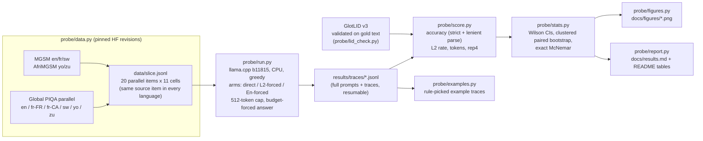

# Tiny Aya in-language reasoning probe: Canadian French and a low-resource tier, on CPU

Does making a small multilingual model **reason in the user's language** cost accuracy, compared with reasoning in English? Cohere Labs' [Multilingual Bridges](https://cohere.com/blog/building-multilingual-bridges) post (Oct 6, 2026; arXiv 2609.10445) reports four numbers for this question: the **L2 reasoning rate** (language ID over each trace), **accuracy**, **thinking tokens**, and a **repetition score** that catches doomlooping. This repo measures the same four numbers on a small slice that matters in Canada: **Canadian French** (Global PIQA `fra_latn_cana`), France French, and a low-resource tier (**Swahili, Yoruba, Zulu**). English is the control. Everything runs on one shared CPU box with no paid API.

> **Substitution, stated up front.** The brief's target pair, [`tiny-aya-l2-thinker`](https://huggingface.co/CohereLabs/tiny-aya-l2-thinker) and [`tiny-aya-en-thinker`](https://huggingface.co/CohereLabs/tiny-aya-en-thinker), is **gated** on Hugging Face. The build box has no HF token, every download returns HTTP 401, and no ungated mirror or GGUF of either model exists. This study therefore runs the documented substitute that the blog itself uses as its baseline: **inference-time language forcing**. The same model reasons with its opening words prefilled in the prompt language (*L2-forced*) or in English (*En-forced*). The model is the ungated official [`tiny-aya-global` Q4_K_M GGUF](https://huggingface.co/CohereLabs/tiny-aya-global-GGUF), which belongs to the same 3.35B Tiny Aya family and uses the same tokenizer. **None of the numbers below are L2-Thinker or En-Thinker numbers.** [`scripts/run_thinkers.sh`](scripts/run_thinkers.sh) swaps in the real thinkers once a token is available; it is **untested**.

## At a glance

<!-- GLANCE:start -->
_Filled in from results once the run completes._
<!-- GLANCE:end -->

## Pipeline



## Method

| | |
|---|---|
| Model | `tiny-aya-global-q4_k_m.gguf` (CohereLabs/tiny-aya-global-GGUF @ `a602ea7`, sha256 `d01d9952…`), served by llama.cpp `b11815` (CPU, `--jinja` chat template, `--swa-full` for prefix-cache reuse) |
| Items | 20 items per cell, sampled once with seed `20261022` and **shared across languages**: MGSM is parallel across languages and AfriMGSM translates the same 250 questions (gold answers align 250/250, asserted in `probe/data.py`); Global PIQA *parallel* shares `example_id` across languages. Every cross-language and cross-arm comparison is therefore paired. |
| Arms | **direct**: answer line prefilled, no reasoning (is reasoning worth anything here?). **L2-forced**: "Think step by step in the same language as the question" plus the reasoning prefilled with the dataset's own human-translated "Step-by-step answer:" phrase (MGSM / AfriMGSM exemplars; Zulu's phrase was written by the author and is not native-checked, see [`probe/langs.py`](probe/langs.py)). **En-forced**: "Think step by step in English" plus a "Step-by-Step Answer:" prefill. |
| Decoding | Greedy (temperature 0, top-k 1), so runs are reproducible. The reasoning cap is 512 generated tokens. On a cap hit the answer is budget-forced (`\n#### ` appended, 12 more tokens), and the hit is logged per trace. |
| Accuracy | *Lenient* (primary): the `#### <answer>` line if one exists, else the last number (math) or the last standalone option letter (PIQA). *Strict*: only the `####` line counts. Both are reported, and the gap is the format-compliance cost. |
| L2 rate | GlotLID v3 (`cis-lmu/glotlid` @ `85cd671`) on the whole trace, after math, LaTeX and numbers are stripped. The trace counts as L2 if the label is the prompt language (Swahili accepts `swh/swa/swc`). The prefilled opener is excluded, so only model-written text is scored. A sentence-level share is also computed. |
| Tokens | Generated tokens per trace (llama.cpp `predicted_n`, including the 3–5-token answer line). Both arms share one tokenizer, so token comparisons are fair within this study but not against the blog's numbers. |
| Repetition | `rep4` = 1 − unique/total word 4-grams in the trace, a simple version of the blog's "how often short sequences repeat". |
| Stats | Wilson 95% intervals for rates; a paired bootstrap (10k resamples) for L2−En differences, **clustered by source item** so the pooled cross-language numbers do not treat translations of one question as independent; exact McNemar on discordant pairs. n=20 per cell is small: single-cell intervals are about ±20 pp wide, and pooled rows carry the weight. |

### Is the language ID trustworthy here?


*Data: [`results/lid_validation.json`](results/lid_validation.json) · script: [`probe/lid_check.py`](probe/lid_check.py) · figure: [`probe/figures.py`](probe/figures.py).* GlotLID was run on the slice's own human-written questions before it was used on traces. Swahili sometimes comes back as Congo Swahili (`swc`), which counts as Swahili; Zulu is sometimes confused with other Nguni languages, so a lenient Zulu rate (also accepting `xho/nbl/ssw/nde`) is reported alongside. **GlotLID has a single `fra_Latn` label**, so the L2 rate cannot tell Canadian French from France French. The fr-CA result is about reasoning *on* Québécois-authored items, not about producing Québécois-register traces.

<!-- RESULTS-BODY:start -->
_Results sections are generated after the run completes._
<!-- RESULTS-BODY:end -->

## Reproduce

```bash
python -m venv .venv && . .venv/bin/activate
bash scripts/setup.sh                 # pinned llama.cpp b11815, GGUF and GlotLID, sha256-checked
bash scripts/reproduce.sh             # slice -> LID check -> generation -> score -> figures -> tables
SKIP_GENERATION=1 bash scripts/reproduce.sh   # rescore/replot the committed traces only (< 1 min)
python -m pytest -q tests
```

## Licences and attribution

Code: MIT. MGSM and Global PIQA are CC-BY-SA-4.0; AfriMGSM is Apache-2.0. `data/slice.jsonl` is a derived subset with the same licences. Tiny Aya Global is CC-BY-NC-4.0, so the committed traces are model outputs released for non-commercial research. GlotLID: see `cis-lmu/glotlid`.
