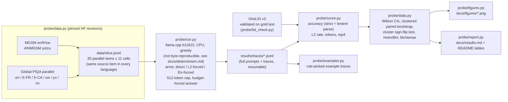
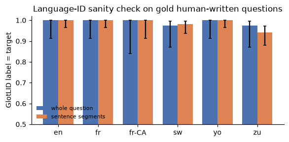
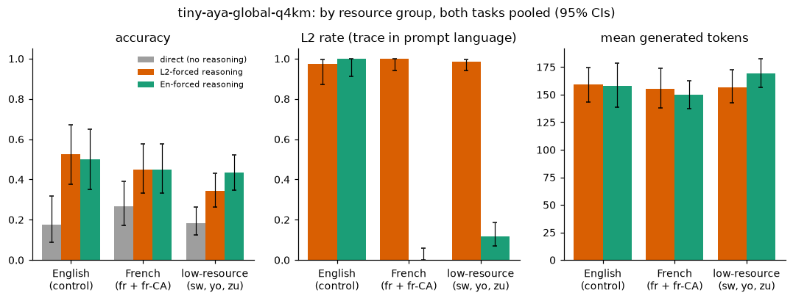
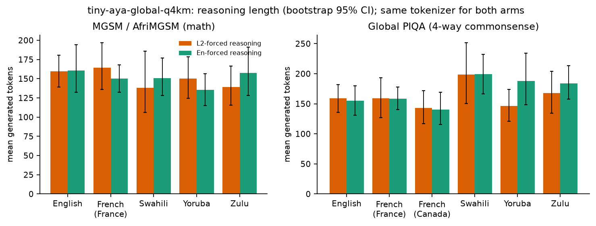
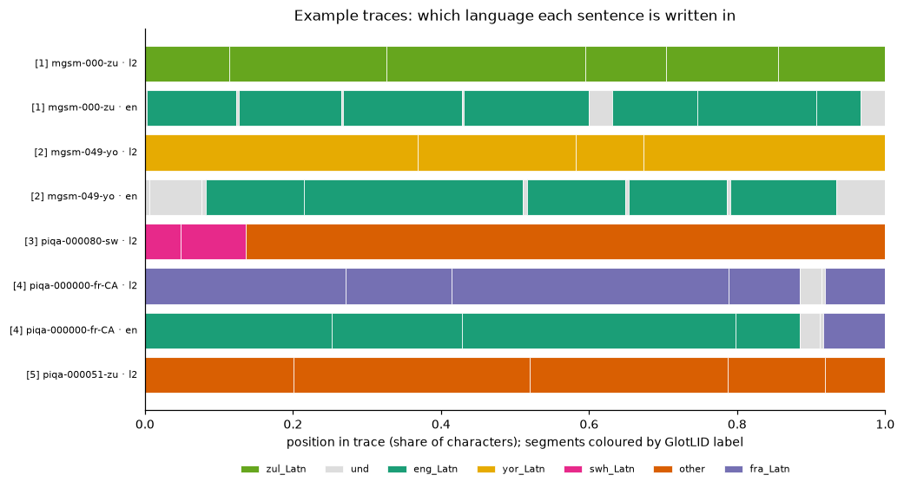
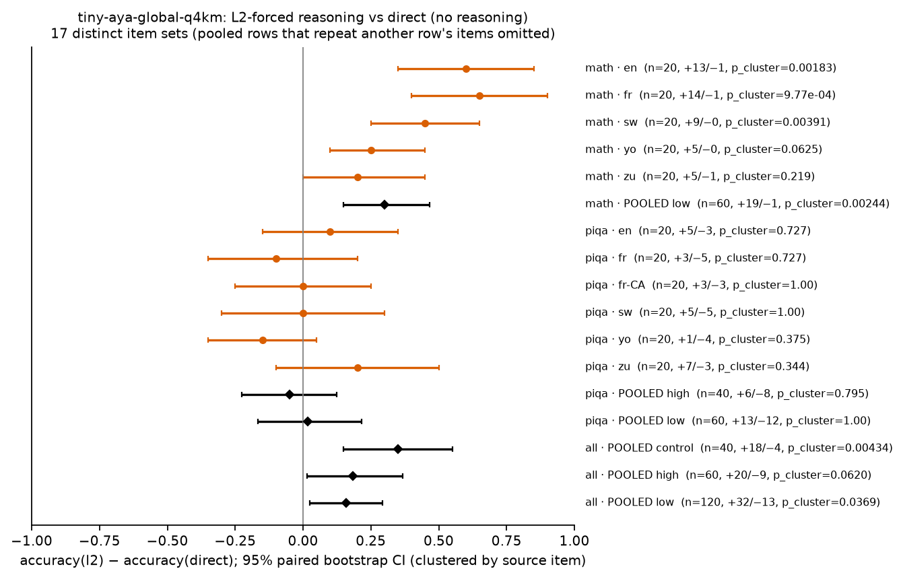

# Tiny Aya in-language reasoning probe: Canadian French and a low-resource tier, on CPU (Tiny Aya Global Q4_K_M substitute; not the Thinkers)

Does making a small multilingual model **reason in the user's language** cost accuracy, compared with reasoning in English? Cohere Labs' [Multilingual Bridges](https://cohere.com/blog/building-multilingual-bridges) post (Oct 6, 2026; arXiv 2609.10445) reports four numbers for this question: the **L2 reasoning rate** (language ID over each trace), **accuracy**, **thinking tokens**, and a **repetition score** that catches doomlooping. This repo measures the same four numbers on a small slice that matters in Canada: **Canadian French** (Global PIQA `fra_latn_cana`), France French, and a low-resource tier (**Swahili, Yoruba, Zulu**). English is the control. Everything runs on one shared CPU box with no paid API.

> **Substitution, stated up front.** The brief's target pair, [`tiny-aya-l2-thinker`](https://huggingface.co/CohereLabs/tiny-aya-l2-thinker) and [`tiny-aya-en-thinker`](https://huggingface.co/CohereLabs/tiny-aya-en-thinker), is gated on Hugging Face with `gated: auto`: a free HF account plus a click-through licence, with no manual approval. They are not unobtainable, but this build box has no HF token, so every download returned HTTP 401, and no ungated mirror or GGUF of either model exists. This study therefore uses the same *kind* of inference-time language forcing that the paper uses as its baseline. Note that the paper (§3.5) applies that forcing to **Qwen3.5-4B**, not to a Tiny Aya model, and its thinking-prefix variant uses a translated "Here's a thinking process…" phrase rather than this repo's openers. The same model reasons with its opening words prefilled in the prompt language (*L2-forced*) or in English (*En-forced*). The model is the ungated official [`tiny-aya-global` Q4_K_M GGUF](https://huggingface.co/CohereLabs/tiny-aya-global-GGUF), which belongs to the same 3.35B Tiny Aya family and uses the same tokenizer. It is *not* the Thinkers' starting point: the Thinkers are trained from `tiny-aya-base-32K`, while Global lists `CohereLabs/tiny-aya-base` as its base model on its card. **None of the numbers below are L2-Thinker or En-Thinker numbers.** [`scripts/run_thinkers.sh`](scripts/run_thinkers.sh) swaps in the real thinkers once a token is available; it is **untested**.

## At a glance

<!-- GLANCE:start (generated by probe/report.py, do not edit) -->
**Exploratory.** No comparison was pre-specified. Across the 17 distinct L2-vs-En tests, **none is significant** at 0.05 under the cluster-aware test, before or after Holm correction. The rows show direction and size, not established effects.

| comparison: L2-forced minus En-forced accuracy | Δ [95% clustered-bootstrap CI] | n pairs (source-item clusters) | cluster sign-flip p (primary) | Holm-adjusted p | exact McNemar p (ignores clustering) |
|---|---|---|---|---|---|
| Math, low-resource tier (sw, yo, zu) | -15 pp [-30, -2] | 60 (20) | 0.0938 | 1.00 | 0.0490 |
| Math, French | +0 pp [-20, +20] | 20 (20) | 1.00 | 1.00 | 1.00 |
| Math, English control | +5 pp [-15, +25] | 20 (20) | 1.00 | 1.00 | 1.00 |
| Commonsense, Canadian French | -5 pp [-35, +25] | 20 (20) | 1.00 | 1.00 | 1.00 |
| Commonsense, French (both locales) | +0 pp [-25, +25] | 40 (20) | 1.00 | 1.00 | 1.00 |
| Commonsense, low-resource tier | -3 pp [-18, +12] · **heterogeneous** (per-language Δ from -15 to +20 pp) | 60 (20) | 0.836 | 1.00 | 0.845 |
| Both tasks, low-resource tier | -9 pp [-20, +2] · **heterogeneous** (per-language Δ from -20 to +20 pp) | 120 (40) | 0.136 | 1.00 | 0.126 |
| Both tasks, French | +0 pp [-18, +19] | 60 (40) | 1.00 | 1.00 | 1.00 |

L2 rate on low-resource prompts: **98%** of L2-forced traces [94, 100] vs 12% of En-forced traces (n=120 / 120). Mean generated tokens: 157 (L2) vs 169 (En). Cap hits: 2 (L2) vs 1 (En).
<!-- GLANCE:end -->

## Pipeline



## Method

| | |
|---|---|
| Model | `tiny-aya-global-q4_k_m.gguf` (CohereLabs/tiny-aya-global-GGUF @ `a602ea7`, sha256 `d01d9952…`), served by llama.cpp `b11815` (CPU, `--jinja` chat template, `--swa-full` for prefix-cache reuse) |
| Items | 20 items per cell, sampled once with seed `20261022` and **shared across languages**: MGSM is parallel across languages and AfriMGSM translates the same 250 questions (gold answers align 250/250, asserted in `probe/data.py`); Global PIQA *parallel* shares `example_id` across languages. Every cross-language and cross-arm comparison is therefore paired. |
| Arms | **direct**: answer line prefilled, no reasoning (is reasoning worth anything here?). **L2-forced**: "Think step by step in the same language as the question" plus the reasoning prefilled with the dataset's own human-translated "Step-by-step answer:" phrase (MGSM / AfriMGSM exemplars; Zulu's phrase was written by the author and is not native-checked, see [`probe/langs.py`](probe/langs.py)). **En-forced**: "Think step by step in English" plus a "Step-by-Step Answer:" prefill. |
| Decoding | Greedy (temperature 0, top-k 1). **Greedy is not byte-reproducible on this CPU build.** Re-generating 6 committed requests 5 times gave different text in 20 of the 30 rerun-vs-committed comparisons, and no scored answer changed. The data and the caveats are in [`docs/determinism.md`](docs/determinism.md). The committed traces were generated with `-np 2`, 2 workers and the prompt cache on. Future runs default to `-np 1`, 1 worker and no prompt cache, which is more conservative but still not byte-stable. Scoring of the committed traces *is* byte-reproducible. The reasoning cap is 512 generated tokens. On a cap hit the answer is budget-forced (`\n#### ` appended, 12 more tokens), and the hit is logged per trace. |
| Accuracy | *Lenient* (primary): the `#### <answer>` line if one exists, else the last number (math) or the last standalone option letter (PIQA). *Strict*: only the `####` line counts. Both are reported, and the gap is the format-compliance cost. |
| L2 rate | GlotLID v3 (`cis-lmu/glotlid` @ `85cd671`) on the whole trace, after math, LaTeX and numbers are stripped. The trace counts as L2 if the label is the prompt language (Swahili accepts `swh/swa/swc`). The prefilled opener is excluded, so only model-written text is scored. A sentence-level share is also computed. |
| Tokens | Generated tokens per trace (llama.cpp `predicted_n`, including the 3–5-token answer line). Both arms share one tokenizer, so token comparisons are fair within this study but not against the blog's numbers. |
| Repetition | `rep4` = 1 − unique/total word 4-grams in the trace. This equals the paper's Eq. 1, Σ_{c>1}(c−1)/Σc over 4-gram counts. |
| Stats | Wilson 95% intervals for rates; a paired bootstrap (10k resamples) for L2−En differences, **clustered by source item** so the pooled cross-language numbers do not treat translations of one question as independent. The **primary test is an exact sign-flip test over source-item clusters** (per-question sums of L2−En correctness; all 2^k sign patterns enumerated). Exact McNemar on discordant traces is shown for reference only, because it assumes independent traces. Holm and Benjamini–Hochberg corrections are applied across the 17 distinct L2-vs-En tests (rows that repeat another row's items, e.g. a "pooled" group with one language, are counted once). p-values are printed to 3 significant digits. **No comparison was pre-registered; all are exploratory.** n=20 per cell is small: single-cell intervals are about ±20 pp wide, and pooled rows carry the weight. |

### Is the language ID trustworthy here?



**Figure 1.** *Data: [`results/lid_validation.json`](results/lid_validation.json) · script: [`probe/lid_check.py`](probe/lid_check.py) · figure: [`probe/figures.py`](probe/figures.py).* GlotLID was run on the slice's own gold questions before it was used on traces. These are human translations for MGSM and AfriMGSM, but Global PIQA *parallel* items were machine-translated from English and then corrected by a native speaker (per its dataset card), so they are post-edited MT, not originally authored text. Swahili sometimes comes back as Congo Swahili (`swc`), which counts as Swahili; Zulu is sometimes confused with other Nguni languages, so a lenient Zulu rate (also accepting `xho/nbl/ssw/nde`) is reported alongside. **GlotLID has a single `fra_Latn` label**, so the L2 rate cannot tell Canadian French from France French. The fr-CA result is about reasoning *on* Global PIQA's fr-CA items (English items machine-translated and then post-edited by a native speaker, so not Québécois-authored), not about producing Québécois-register traces. Cultural readings of the fr-CA numbers should be made with that in mind.

## Results

All numbers below are produced from the committed traces by [`probe/score.py`](probe/score.py) → [`results/summary.json`](results/summary.json) / [`results/paired.json`](results/paired.json) / [`results/per_trace.csv`](results/per_trace.csv). The tables are spliced in by [`probe/report.py`](probe/report.py), and every figure comes from [`probe/figures.py`](probe/figures.py). Full tables: [`docs/results.md`](docs/results.md).

### 1. Accuracy by language and arm


**Figure 2.** *Data: [`results/summary.json`](results/summary.json) · script: [`probe/figures.py`](probe/figures.py) (`fig_accuracy`).*

- **Reasoning matters a lot for math, in any language.** Direct answering scores 0–5% on every math language. Either reasoning arm lifts English and French to 60–70% (paired L2 vs direct on English and French math: +60 and +65 pp, exact McNemar p = 0.00183 and 0.000977; see [`docs/results.md`](docs/results.md)). These are single-language cells (one trace per question, so no clustering issue), and both stay below 0.05 even after Bonferroni ×17 (0.0311 and 0.0166).
- **For French, no difference was detected between the two reasoning languages.** French math is 70% vs 70%, with 2 items won by each arm. English (the control, where both arms mostly reason in English) is 65% vs 60%.
- **For low-resource math, L2-forced scored lower than En-forced, but this is exploratory and not significant.** Pooled over Swahili, Yoruba and Zulu (60 traces from **20 source questions**), L2-forced is 15 pp lower: 32% vs 47%, clustered-bootstrap 95% CI [−30, −2], with 4 vs 13 discordant traces. The 60 traces are translations of the same 20 questions, so the primary test is an exact sign-flip test on the 20 per-question differences: **p = 0.0938**. (Exact McNemar, which treats the 60 traces as independent, gives 0.0490.) After Holm correction across the 17 distinct L2-vs-En tests, adjusted p = 1.00 (cluster) and 0.834 (McNemar). The percentile CI excluding 0 does not agree with the cluster test, and with 20 clusters the percentile bootstrap tends to be too narrow. Every low-resource language points the same way (sw −20, yo −15, zu −10 pp), but each is n = 20. Read this as a direction worth testing with more items, not as an established cost.
- **Commonsense (Global PIQA): no measurable effect of reasoning language, and reasoning barely helps.** Accuracy is 25–55% for every arm and language (chance is 25%). On PIQA, L2-forced vs direct is −5 to +10 pp across the pooled groups, with every interval including 0. On **Canadian French**, L2-forced is 35% and En-forced is 40% (−5 pp [−35, +25], 5 vs 6 discordant items). France French is 30% vs 25%. The pooled low-resource PIQA difference is −3 pp [−18, +12]. Zulu (+20 pp) and Yoruba (−15 pp) point in opposite directions, so the pooled row averages opposing effects (flagged *heterogeneous* in the glance table) and no consistent low-resource pattern is visible at n = 20.

### 2. Did the forcing actually change the reasoning language? (L2 rate)


**Figure 3.** *Data: [`results/summary.json`](results/summary.json) (`l2`, `en_trace`) · per-trace labels: [`results/per_trace.csv`](results/per_trace.csv) · script: [`probe/figures.py`](probe/figures.py) (`fig_lid_heatmap`).*

The manipulation worked: the L2-forced arm reasons in the prompt language for nearly every trace, including Yoruba and Zulu, and the En-forced arm mostly reasons in English. The arms therefore differ in the language of the reasoning, which is the variable under study. The leak goes one way: some *En-forced* Swahili math traces drift back into Swahili, but L2-forced traces almost never drift into English.


**Figure 4.** *Data: [`results/per_trace.csv`](results/per_trace.csv) (`target_share`, `english_share`) and [`results/trace_lid_check.json`](results/trace_lid_check.json) · script: [`probe/trace_lid_check.py`](probe/trace_lid_check.py), [`probe/figures.py`](probe/figures.py) (`fig_trace_lid`).*

**Language-ID check on the traces themselves.** A whole-trace label can hide code-switching, so every trace was also split into sentences and each sentence labelled. The whole-trace label is cross-checked against the majority sentence label, and GlotLID's confidence is recorded in [`results/trace_lid_check.json`](results/trace_lid_check.json). Swahili disagreements are mostly `swh` vs `swc` (both Swahili). The few en-arm outliers are traces dominated by numbers and option text quoted from the prompt.

### 3. Tokens, repetition and doomlooping


**Figure 5.** *Data: [`results/per_trace.csv`](results/per_trace.csv) (`gen_tokens`, `rep4`, `cap_hit`) · script: [`probe/figures.py`](probe/figures.py) (`fig_rep_scatter`).*



**Figure 6.** *Data: [`results/summary.json`](results/summary.json) (`…|all|group:*`) · script: [`probe/figures.py`](probe/figures.py) (`fig_groups`).*



**Figure 7.** *Data: [`results/summary.json`](results/summary.json) (`tokens`) · script: [`probe/figures.py`](probe/figures.py) (`fig_tokens`).*

Traces are short for both arms: median 148 generated tokens, 5th–95th percentile 69–294, across all 440 reasoning traces. Only 3 of the 440 hit the 512-token cap. Repetition and length are positively correlated (Spearman ρ = 0.49 for L2-forced and 0.53 for En-forced, n = 220 each, tied values given average ranks; shown on the plot), which matches the blog's observation in miniature. At this scale, though, doomlooping is a handful of traces, not a regime. Forcing in-language reasoning does **not** make this model think longer.

### 4. Error analysis of the low-resource math discordant pairs (exploratory)


**Figure 8.** *Data: [`results/per_trace.csv`](results/per_trace.csv) (`eq_steps`, `list_lines`) and [`results/error_coding_summary.json`](results/error_coding_summary.json) (`structure_math`) · script: [`probe/metrics.py`](probe/metrics.py) (`structure`), [`probe/error_coding.py`](probe/error_coding.py), [`probe/figures.py`](probe/figures.py) (`fig_structure`).*

**Coding of all 17 discordant pairs.** Of the 60 low-resource math pairs, 13 were right only under En-forcing and 4 only under L2-forcing. I read every one of these 34 traces and coded the first error in the losing trace that alone makes its answer wrong. The raw coding, with a one-line justification per item, is committed as data: [`results/error_coding.csv`](results/error_coding.csv), summarized by [`probe/error_coding.py`](probe/error_coding.py) into [`results/error_coding_summary.json`](results/error_coding_summary.json). One coder (me) did the coding after seeing which arm was right, so it was not blinded and has no inter-rater check.

| losing trace's first error | L2 lost (13 en-only pairs) | En lost (4 l2-only pairs) |
|---|---:|---:|
| dropped a stated condition or quantity | 4 (058-sw, 090-sw, 012-yo, 210-yo) | 2 (049-yo, 241-sw) |
| wrong operation or sign on the right quantities | 4 (050-yo, 058-zu, 060-zu, 090-zu) | 1 (148-zu) |
| solved a different problem (wrong setup) | 4 (000-zu, 015-sw, 015-yo, 060-sw) | 1 (210-zu) |
| doomloop until the 512-token cap | 1 (174-sw) | 0 |
| **winning trace itself reached gold through a visibly wrong step** | 3 (000-zu, 012-yo, 210-yo) | 1 (241-sw) |

No single cause dominates. L2 losses split evenly across dropped conditions, wrong operations and wrong setups, and En losses are the same kinds of error. Four of the 17 "wins" are themselves flawed. For example, in `mgsm-012-yo` (gold 13) the L2 trace ignores the $90 planting cost and divides revenue by upkeep (→ 4). The En trace does use the cost, but it computes 90 / 7.5 as "12.2" (it is exactly 12) and then rounds up, so its 13 comes from wrong arithmetic plus rounding. In `mgsm-210-yo` the En trace reaches 10 as $50 / $5, which drops both the savings and the mowing rate. Per-item notes are in the CSV; no item was selected for this section, because all 17 are listed.

**Structure.** The two arms also write in different *styles*. En-forced traces on low-resource prompts are enumerated derivations (6.1–7.8 list lines per trace), while L2-forced Swahili, Yoruba and Zulu traces are one prose paragraph (0–0.3 list lines). Explicit arithmetic steps (`=` signs per trace, mean [bootstrap 95% CI], n = 20 each) do **not** move consistently with the arm:

| math, `=` per trace | en | fr | sw | yo | zu |
|---|---|---|---|---|---|
| L2-forced | 5.2 [4.3, 6.1] | 4.3 [3.4, 5.1] | **5.3 [2.9, 9.9]** | 2.6 [2.0, 3.3] | 3.6 [2.8, 4.5] |
| En-forced | 6.2 [5.0, 7.6] | 4.5 [3.7, 5.3] | 4.5 [3.7, 5.5] | 4.3 [3.3, 5.7] | 5.2 [4.1, 6.5] |

Swahili, the language with the largest accuracy drop (−20 pp), runs the *other* way: L2 traces have more `=` steps than En traces. That mean is driven by the one doomloop trace (174-sw, 45 `=` signs); without it the Swahili L2 mean is 3.3 vs 4.5, and the medians are 3 vs 4. Fewer explicit steps therefore cannot be the general explanation, and I do not offer one.

**Confounds.** List structure is almost perfectly collinear with arm × language here: prose appears only in L2-forced low-resource traces, which are also the only traces in Swahili, Yoruba or Zulu. The En arm's prefill (`Step-by-Step Answer:`) invites a numbered list, while the L2 openers are prose sentences. The data therefore cannot separate "reasoning in L2", "reasoning in prose" and "a different opener". Telling them apart would need an L2-forced arm with an in-language "use a numbered list" instruction, which was not run. Annotated traces chosen by the fixed rules in [`probe/examples.py`](probe/examples.py) are in [`docs/examples.md`](docs/examples.md).



**Figure 9.** *Data: [`results/examples.json`](results/examples.json) · script: [`probe/examples.py`](probe/examples.py), [`probe/figures.py`](probe/figures.py) (`fig_strips`).*

### 5. Paired differences

![Forest plot of accuracy(L2-forced) minus accuracy(En-forced), one row for each of the 17 distinct item sets in the Holm/BH family: 11 task × language cells, then pooled rows (math low; PIQA high and low; both tasks control, high and low). Pooled rows that repeat another row's items, such as math · POOLED high (= math · fr), are omitted. Each row has a 95% paired bootstrap interval clustered by source item, plus the n, discordant counts, cluster sign-flip p and Holm-adjusted p. No row is significant after correction; the smallest cluster p is 0.0938 for math · POOLED low.](docs/figures/paired_l2_vs_en.png)

**Figure 10.** *Data: [`results/paired.json`](results/paired.json) · script: [`probe/stats.py`](probe/stats.py), [`probe/figures.py`](probe/figures.py) (`fig_forest`).*



**Figure 11.** *Data: [`results/paired.json`](results/paired.json) · script: [`probe/figures.py`](probe/figures.py) (`fig_forest`).*

### Tables

<!-- RESULTS:start (generated by probe/report.py, do not edit) -->
**Math (MGSM / AfriMGSM)**

| language | arm | n | accuracy [95% CI] | L2 rate [95% CI] | English-trace rate | mean tokens [95% CI] | mean rep4 | cap hits | unparsed |
|---|---|---:|---|---|---|---|---|---:|---:|
| English | direct | 20 | 5% [1, 24] | – | – | – | – | – | 0 |
| English | l2 | 20 | 65% [43, 82] | 95% [76, 99] | 95% | 159 [139, 181] | 0.034 | 0 | 0 |
| English | en | 20 | 60% [39, 78] | 100% [84, 100] | 100% | 161 [132, 194] | 0.033 | 0 | 0 |
| French (France) | direct | 20 | 5% [1, 24] | – | – | – | – | – | 0 |
| French (France) | l2 | 20 | 70% [48, 85] | 100% [84, 100] | 0% | 164 [136, 197] | 0.037 | 0 | 0 |
| French (France) | en | 20 | 70% [48, 85] | 0% [0, 16] | 100% | 150 [133, 168] | 0.019 | 0 | 0 |
| Swahili | direct | 20 | 0% [0, 16] | – | – | – | – | – | 0 |
| Swahili | l2 | 20 | 45% [26, 66] | 100% [84, 100] | 0% | 138 [106, 186] | 0.067 | 1 | 0 |
| Swahili | en | 20 | 65% [43, 82] | 20% [8, 42] | 75% | 151 [128, 177] | 0.018 | 0 | 0 |
| Yoruba | direct | 20 | 0% [0, 16] | – | – | – | – | – | 0 |
| Yoruba | l2 | 20 | 25% [11, 47] | 100% [84, 100] | 0% | 150 [124, 179] | 0.086 | 0 | 0 |
| Yoruba | en | 20 | 40% [22, 61] | 5% [1, 24] | 90% | 136 [115, 156] | 0.023 | 0 | 0 |
| Zulu | direct | 20 | 5% [1, 24] | – | – | – | – | – | 0 |
| Zulu | l2 | 20 | 25% [11, 47] | 100% [84, 100] | 0% | 139 [115, 166] | 0.019 | 0 | 0 |
| Zulu | en | 20 | 35% [18, 57] | 5% [1, 24] | 90% | 157 [128, 191] | 0.016 | 0 | 0 |

**Commonsense (Global PIQA, 4-way, chance = 25%)**

| language | arm | n | accuracy [95% CI] | L2 rate [95% CI] | English-trace rate | mean tokens [95% CI] | mean rep4 | cap hits | unparsed |
|---|---|---:|---|---|---|---|---|---:|---:|
| English | direct | 20 | 30% [15, 52] | – | – | – | – | – | 1 |
| English | l2 | 20 | 40% [22, 61] | 100% [84, 100] | 100% | 159 [136, 182] | 0.029 | 0 | 0 |
| English | en | 20 | 40% [22, 61] | 100% [84, 100] | 100% | 155 [131, 180] | 0.029 | 0 | 0 |
| French (France) | direct | 20 | 40% [22, 61] | – | – | – | – | – | 1 |
| French (France) | l2 | 20 | 30% [15, 52] | 100% [84, 100] | 0% | 159 [127, 193] | 0.037 | 0 | 0 |
| French (France) | en | 20 | 25% [11, 47] | 0% [0, 16] | 100% | 158 [140, 178] | 0.045 | 0 | 0 |
| French (Canada) | direct | 20 | 35% [18, 57] | – | – | – | – | – | 1 |
| French (Canada) | l2 | 20 | 35% [18, 57] | 100% [84, 100] | 0% | 143 [117, 172] | 0.032 | 0 | 0 |
| French (Canada) | en | 20 | 40% [22, 61] | 0% [0, 16] | 100% | 140 [115, 169] | 0.029 | 0 | 0 |
| Swahili | direct | 20 | 30% [15, 52] | – | – | – | – | – | 1 |
| Swahili | l2 | 20 | 30% [15, 52] | 95% [76, 99] | 0% | 199 [150, 252] | 0.110 | 1 | 0 |
| Swahili | en | 20 | 45% [26, 66] | 10% [3, 30] | 90% | 199 [166, 232] | 0.051 | 0 | 0 |
| Yoruba | direct | 20 | 40% [22, 61] | – | – | – | – | – | 1 |
| Yoruba | l2 | 20 | 25% [11, 47] | 100% [84, 100] | 0% | 146 [121, 174] | 0.129 | 0 | 0 |
| Yoruba | en | 20 | 40% [22, 61] | 15% [5, 36] | 85% | 188 [148, 234] | 0.063 | 1 | 0 |
| Zulu | direct | 20 | 35% [18, 57] | – | – | – | – | – | 2 |
| Zulu | l2 | 20 | 55% [34, 74] | 95% [76, 99] | 0% | 168 [134, 204] | 0.068 | 0 | 0 |
| Zulu | en | 20 | 35% [18, 57] | 15% [5, 36] | 85% | 184 [158, 213] | 0.042 | 0 | 0 |

**Paired L2-forced vs En-forced**

| task | slice | n pairs (clusters) | acc l2 | acc en | Δ (l2−en) [95% clustered CI] | l2-only right | en-only right | cluster sign-flip p | Holm p | BH q | exact McNemar p (ignores clustering) | Δ tokens [95% CI] |
|---|---|---:|---:|---:|---|---:|---:|---:|---:|---:|---:|---|
| math | en | 20 (20) | 65% | 60% | +5 pp [-15, +25] | 3 | 2 | 1.00 | 1.00 | 1.00 | 1.00 | -1 [-24, +18] |
| math | fr | 20 (20) | 70% | 70% | +0 pp [-20, +20] | 2 | 2 | 1.00 | 1.00 | 1.00 | 1.00 | +14 [-9, +39] |
| math | sw | 20 (20) | 45% | 65% | -20 pp [-45, +0] | 1 | 5 | 0.219 | 1.00 | 1.00 | 0.219 | -13 [-38, +19] |
| math | yo | 20 (20) | 25% | 40% | -15 pp [-35, +5] | 1 | 4 | 0.375 | 1.00 | 1.00 | 0.375 | +15 [-10, +40] |
| math | zu | 20 (20) | 25% | 35% | -10 pp [-35, +15] | 2 | 4 | 0.688 | 1.00 | 1.00 | 0.688 | -18 [-53, +16] |
| piqa | en | 20 (20) | 40% | 40% | +0 pp [-30, +30] | 4 | 4 | 1.00 | 1.00 | 1.00 | 1.00 | +4 [-11, +19] |
| piqa | fr | 20 (20) | 30% | 25% | +5 pp [-25, +35] | 5 | 4 | 1.00 | 1.00 | 1.00 | 1.00 | +1 [-37, +38] |
| piqa | fr-CA | 20 (20) | 35% | 40% | -5 pp [-35, +25] | 5 | 6 | 1.00 | 1.00 | 1.00 | 1.00 | +3 [-37, +39] |
| piqa | sw | 20 (20) | 30% | 45% | -15 pp [-50, +20] | 5 | 8 | 0.581 | 1.00 | 1.00 | 0.581 | -1 [-53, +57] |
| piqa | yo | 20 (20) | 25% | 40% | -15 pp [-35, +5] | 1 | 4 | 0.375 | 1.00 | 1.00 | 0.375 | -41 [-93, +3] |
| piqa | zu | 20 (20) | 55% | 35% | +20 pp [-5, +45] | 6 | 2 | 0.289 | 1.00 | 1.00 | 0.289 | -17 [-56, +20] |
| math | **pooled control** (= en) | 20 (20) | 65% | 60% | +5 pp [-15, +25] | 3 | 2 | 1.00 | 1.00 | 1.00 | 1.00 | -1 [-24, +18] |
| math | **pooled high** (= fr) | 20 (20) | 70% | 70% | +0 pp [-20, +20] | 2 | 2 | 1.00 | 1.00 | 1.00 | 1.00 | +14 [-9, +39] |
| math | **pooled low** | 60 (20) | 32% | 47% | -15 pp [-30, -2] | 4 | 13 | 0.0938 | 1.00 | 1.00 | 0.0490 | -5 [-22, +14] |
| piqa | **pooled control** (= en) | 20 (20) | 40% | 40% | +0 pp [-30, +30] | 4 | 4 | 1.00 | 1.00 | 1.00 | 1.00 | +4 [-11, +19] |
| piqa | **pooled high** | 40 (20) | 32% | 32% | +0 pp [-25, +25] | 10 | 10 | 1.00 | 1.00 | 1.00 | 1.00 | +2 [-34, +35] |
| piqa | **pooled low** | 60 (20) | 37% | 40% | -3 pp [-18, +12] | 12 | 14 | 0.836 | 1.00 | 1.00 | 0.845 | -20 [-47, +9] |
| all | **pooled control** | 40 (40) | 52% | 50% | +2 pp [-15, +20] | 7 | 6 | 1.00 | 1.00 | 1.00 | 1.00 | +1 [-13, +14] |
| all | **pooled high** | 60 (40) | 45% | 45% | +0 pp [-18, +19] | 12 | 12 | 1.00 | 1.00 | 1.00 | 1.00 | +6 [-19, +30] |
| all | **pooled low** | 120 (40) | 34% | 43% | -9 pp [-20, +2] | 16 | 27 | 0.136 | 1.00 | 1.00 | 0.126 | -12 [-29, +5] |

Holm / BH adjust the cluster sign-flip p over the family of **17 distinct** l2-vs-en tests (rows marked “= …” test the same item set as another row and are not counted twice). All comparisons are exploratory; none was pre-registered.
<!-- RESULTS:end -->

## Limitations

- **Not the Thinkers.** Every number is for Tiny Aya Global Q4_K_M under prompt and prefill forcing, which is the *inference-time forcing baseline* the blog argues is inferior to training. The study says nothing direct about L2-Thinker's or En-Thinker's accuracy. It shows what another member of the same family does under prompt forcing. Whether the Thinkers behave differently is untested here, and the Thinkers start from a different checkpoint (`tiny-aya-base-32K`). [`scripts/run_thinkers.sh`](scripts/run_thinkers.sh) is the drop-in path; it is untested.
- **Small n, exploratory.** There are 20 items per cell (40 per language across tasks), and no comparison was pre-registered. Only the pooled low-resource math difference has a percentile-bootstrap interval that excludes 0, and only just. Its primary cluster test is p = 0.0938 (Holm-adjusted 1.00 over 17 tests), so nothing here is significant. Treat the per-language bars as descriptive. More low-resource math items would be the cheapest way to sharpen this; none were added in this round because the shared box is busy.
- **Reasoning language is confounded with style and opener.** In the low-resource cells, L2-forcing changes three things at once: the language of the trace, its form (prose instead of a numbered list), and the prefilled opener (an in-language sentence instead of `Step-by-Step Answer:`). These are collinear in this design, so any accuracy gap cannot be attributed to language alone (see §4).
- **Generation is not byte-reproducible.** Even at temperature 0, 20 of 30 rerun-vs-committed comparisons (6 requests × 5 reruns) differed in wording. Correctness did not change, but all 6 requests come from one easy item ([`docs/determinism.md`](docs/determinism.md)). Treat the 660 committed traces as one draw from a slightly noisy generator. Borderline items could flip on a rerun, which is another reason to read the 4-vs-13 discordant split as exploratory.
- **Q4_K_M and greedy decoding.** Quantization can hurt low-resource languages more than English, and the model card recommends temperature 0.6. Both choices are fixed across arms, so the *comparison* is fair, but absolute accuracies are likely below what bf16 with sampling would give.
- **Canadian French.** fr-CA appears only in Global PIQA; MGSM has no fr-CA split. LID cannot separate fr-CA from fr-FR, and the fr-CA prompts used the France-French MGSM opener ("Réponse étape par étape :").
- **Zulu opener** was written by the author and is not native-checked. **Answer parsing:** lenient parsing (last number or option letter) is the primary metric; strict `####`-only accuracy and format-compliance rates are in [`results/summary.json`](results/summary.json) (`acc_strict`, `format_rate`).
- **The repetition score** uses word 4-grams. The paper's Eq. 1, Σ_{c>1}(c−1)/Σc over n-gram counts c, is algebraically identical to `rep4` = 1 − unique/total, so the formula matches. Only the tokenization may differ from the paper's: here, n-grams are over lower-cased alphabetic words, with numbers and punctuation dropped (`probe/metrics.py`).
- **Possible contamination.** MGSM is a translation of GSM8K test questions, and Global PIQA was public before Tiny Aya was released, so some items may have been seen in training. Both arms see the same items, so this mainly inflates absolute accuracies. It could also bias the paired comparison: if memorized solutions are English, they might favour En-forced reasoning. This study cannot measure that.
- **Compute.** The run was generated on a shared 8-core box under heavy load (load average ≈ 24 from other jobs), on two single-thread llama.cpp servers at about 1 token/s per slot. One server crashed overnight, and generation was resumed from the on-disk JSONL with no lost or duplicated traces (`(id, arm)` uniqueness is checked in `probe/score.py`).


## Reproduce

```bash
python -m venv .venv && . .venv/bin/activate
bash scripts/setup.sh                 # pinned llama.cpp b11815, GGUF and GlotLID, sha256-checked (reproduce.sh also runs it)
bash scripts/reproduce.sh             # slice -> LID check -> generation -> score -> figures -> tables
SKIP_GENERATION=1 bash scripts/reproduce.sh   # rescore/replot the committed traces only: GlotLID (~1.7 GB) + pip deps, no GGUF/llama.cpp, keeps data/slice.jsonl; 74 s on the busy box, and it reproduced every committed result, table and figure byte-for-byte
python -m pytest -q tests
```

## Licences and attribution

Licences differ by path; see [`DATA_LICENSE.md`](DATA_LICENSE.md). In short: code is MIT ([`LICENSE`](LICENSE)). `data/slice.jsonl` is a subset of MGSM (CC-BY-SA-4.0), AfriMGSM (Apache-2.0) and Global PIQA *parallel* (CC-BY-SA-4.0). The traces in `results/traces/` and `docs/examples.md` are Tiny Aya Global outputs (CC-BY-NC-4.0, plus the Cohere Labs Acceptable Use Policy) that contain dataset text. **Global PIQA's card forbids training AI systems on Global PIQA or on synthetic data seeded from it. That restriction applies to the PIQA traces and examples here: use them for evaluation and analysis only, never for training.**
